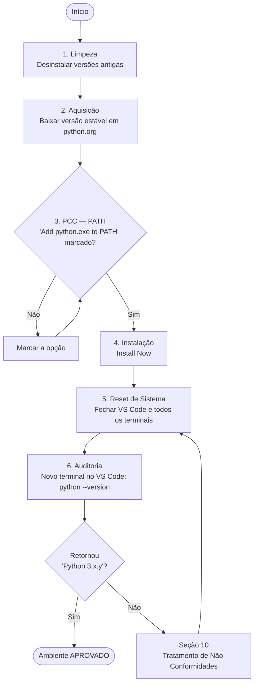

# POP-001 — Instalação Limpa e Auditoria de Ambiente Python no Windows

| Campo                | Informação                                                        |
|----------------------|-------------------------------------------------------------------|
| **Código**           | POP-001                                                           |
| **Título**           | Instalação Limpa e Auditoria de Ambiente Python no Windows        |
| **Versão**           | 1.0                                                               |
| **Data de emissão**  | 03/10/2026                                                        |
| **Área responsável** | Gestão da Qualidade / Infraestrutura de Desenvolvimento           |
| **Elaborado por**    | Gerência Sênior de Qualidade                                      |
| **Revisado por**     | _(preencher)_                                                     |
| **Aprovado por**     | _(preencher)_                                                     |
| **Próxima revisão**  | 03/10/2027 ou a cada nova versão principal do Python              |

---

## Sumário

1. [Objetivo](#1-objetivo)
2. [Escopo e Aplicação](#2-escopo-e-aplicação)
3. [Responsabilidades](#3-responsabilidades)
4. [Definições e Siglas](#4-definições-e-siglas)
5. [Pré-requisitos e Recursos Necessários](#5-pré-requisitos-e-recursos-necessários)
6. [Precauções e Riscos](#6-precauções-e-riscos)
7. [Visão Geral do Fluxo](#7-visão-geral-do-fluxo)
8. [Procedimento Detalhado](#8-procedimento-detalhado)
9. [Critérios de Aceitação](#9-critérios-de-aceitação)
10. [Tratamento de Não Conformidades](#10-tratamento-de-não-conformidades)
11. [Registros e Evidências](#11-registros-e-evidências)
12. [Checklist de Execução](#12-checklist-de-execução)
13. [Histórico de Revisões](#13-histórico-de-revisões)

---

## 1. Objetivo

Padronizar a remoção de instalações defeituosas, a instalação limpa do interpretador Python e a auditoria de validação do ambiente em estações Windows, garantindo que:

- o comando `python` seja reconhecido em qualquer terminal (CMD, PowerShell e terminal integrado do VS Code);
- não existam conflitos entre versões antigas e a nova instalação;
- a conformidade do ambiente seja **verificável, rastreável e reproduzível**.

## 2. Escopo e Aplicação

| Item               | Abrangência                                                                 |
|--------------------|-----------------------------------------------------------------------------|
| **Aplica-se a**    | Estações de trabalho Windows 10 / 11 usadas para desenvolvimento do projeto |
| **Situações**      | Primeira instalação, reinstalação após falha, troca de máquina, onboarding  |
| **Não se aplica a**| Servidores Linux/macOS, ambientes em contêiner, distribuições Anaconda      |

## 3. Responsabilidades

| Papel                        | Responsabilidade                                                                          |
|------------------------------|-------------------------------------------------------------------------------------------|
| **Executor (Desenvolvedor)** | Executar todas as etapas na ordem definida e registrar as evidências.                     |
| **Auditor / Revisor**        | Conferir as evidências da Etapa 6 e liberar o ambiente para uso.                          |
| **Gerência de Qualidade**    | Manter este POP atualizado, tratar não conformidades recorrentes e aprovar revisões.      |

## 4. Definições e Siglas

| Termo                 | Definição                                                                                                   |
|-----------------------|-------------------------------------------------------------------------------------------------------------|
| **POP**               | Procedimento Operacional Padrão.                                                                            |
| **PATH**              | Variável de ambiente que lista os diretórios onde o Windows procura executáveis ao digitar um comando.      |
| **PCC**               | Ponto Crítico de Controle — etapa cuja falha compromete todo o resultado e que, portanto, exige verificação obrigatória. |
| **Instalação limpa**  | Instalação realizada após a remoção completa de versões anteriores.                                         |
| **Alias da Store**    | Atalho do Windows (`python.exe` / `python3.exe`) que redireciona para a Microsoft Store quando o Python real não está no PATH. |
| **VS Code**           | Visual Studio Code, editor de código utilizado no projeto.                                                  |

## 5. Pré-requisitos e Recursos Necessários

- [ ] Conta de usuário com permissão para instalar programas (ou credenciais de administrador disponíveis).
- [ ] Conexão com a internet para download em **https://www.python.org**.
- [ ] VS Code instalado.
- [ ] Trabalho em andamento **salvo** e terminais/editores prontos para serem encerrados (ver Etapa 5).
- [ ] Ao menos 200 MB livres em disco.

## 6. Precauções e Riscos

> ⚠️ **ATENÇÃO**
> - Baixe o instalador **exclusivamente** de `python.org`. Instaladores de sites de terceiros podem conter software malicioso ou versões adulteradas.
> - Desinstalar o Python remove pacotes instalados globalmente via `pip`. Se necessário, gere antes um inventário com `python -m pip freeze > pacotes-antigos.txt`.
> - Não edite a variável PATH manualmente durante este procedimento, salvo instrução da seção 10.

| Risco                                             | Consequência                                      | Mitigação no POP        |
|---------------------------------------------------|---------------------------------------------------|-------------------------|
| Versões antigas coexistindo com a nova            | Comando aponta para o interpretador errado        | Etapa 1 (Limpeza)       |
| Instalador não oficial ou desatualizado           | Falhas de segurança / incompatibilidades          | Etapa 2 (Aquisição)     |
| PATH não configurado                              | `'python' não é reconhecido como comando`         | Etapa 3 (PCC)           |
| Terminais abertos com variáveis antigas em cache  | Falso negativo na validação                       | Etapa 5 (Reset)         |

## 7. Visão Geral do Fluxo



---

## 8. Procedimento Detalhado

### Etapa 1 — Limpeza (remoção de versões com falha)

**Objetivo:** eliminar instalações anteriores para mitigar conflitos de versão e de PATH.

| Passo | Ação                                                                                                   |
|-------|--------------------------------------------------------------------------------------------------------|
| 1.1   | Pressione `Win`, digite **"Adicionar ou remover programas"** e abra a ferramenta.                     |
| 1.2   | No campo de busca da lista, digite **`Python`**.                                                       |
| 1.3   | Para **cada** item listado (ex.: `Python 3.x.y (64-bit)`, `Python Launcher`), clique em **⋯ → Desinstalar** e confirme. |
| 1.4   | Repita a busca e confirme que **nenhum** item "Python" permanece na lista.                            |

**✅ Verificação da etapa:** a busca por "Python" em *Adicionar ou remover programas* não retorna resultados.

> 💡 **Boa prática:** Python instalado pela Microsoft Store também aparece nesta lista e deve ser removido para evitar ambiguidade.

---

### Etapa 2 — Aquisição (download do instalador oficial)

**Objetivo:** obter a versão estável mais recente a partir da fonte oficial.

| Passo | Ação                                                                                                   |
|-------|--------------------------------------------------------------------------------------------------------|
| 2.1   | Acesse **https://www.python.org/downloads/**.                                                          |
| 2.2   | Clique no botão principal **"Download Python 3.x.y"** (o site detecta o Windows automaticamente).      |
| 2.3   | Confirme que o arquivo baixado é o instalador para Windows 64-bit (ex.: `python-3.x.y-amd64.exe`).     |
| 2.4   | Anote a versão baixada no **Registro de Execução** (seção 11).                                         |

**✅ Verificação da etapa:** instalador oficial presente na pasta *Downloads*, versão registrada.

> ℹ️ **Nota:** se o site oferecer como opção principal o **"Python install manager"**, este POP continua válido em seus princípios (limpeza → fonte oficial → PATH → reset → auditoria); siga as instruções exibidas pelo gerenciador e prossiga para a Etapa 5.

---

### Etapa 3 — 🔴 PONTO CRÍTICO DE CONTROLE (PATH)

**Objetivo:** garantir que o Windows localize o `python.exe` a partir de qualquer terminal.

| Passo | Ação                                                                                                   |
|-------|--------------------------------------------------------------------------------------------------------|
| 3.1   | Execute o instalador baixado (duplo clique).                                                           |
| 3.2   | Na **primeira tela**, localize a caixa **`Add python.exe to PATH`** (parte inferior da janela).        |
| 3.3   | **MARQUE OBRIGATORIAMENTE** essa caixa.                                                                |
| 3.4   | Confira visualmente que a caixa está marcada **antes** de qualquer clique em botões de instalação.     |

> 🛑 **PARADA OBRIGATÓRIA**
> É **proibido** prosseguir para a Etapa 4 sem a confirmação do passo 3.4.
> A omissão desta etapa é a **principal causa** do erro `'python' não é reconhecido como um comando interno ou externo`.
> Caso o instalador já tenha sido concluído sem a opção marcada, volte à **Etapa 1**.

**✅ Verificação da etapa:** caixa `Add python.exe to PATH` marcada (recomenda-se registrar *print* da tela como evidência).

---

### Etapa 4 — Instalação (execução padrão)

**Objetivo:** concluir a instalação com as configurações padrão recomendadas.

| Passo | Ação                                                                                                   |
|-------|--------------------------------------------------------------------------------------------------------|
| 4.1   | Ainda na primeira tela, clique em **`Install Now`**.                                                   |
| 4.2   | Se o Controle de Conta de Usuário (UAC) solicitar, clique em **Sim**.                                  |
| 4.3   | Aguarde a barra de progresso até a mensagem **"Setup was successful"**.                                |
| 4.4   | Se exibida a opção **"Disable path length limit"**, clique nela (recomendado; evita erros com caminhos longos). |
| 4.5   | Clique em **Close**.                                                                                   |

**✅ Verificação da etapa:** mensagem *"Setup was successful"* exibida.

---

### Etapa 5 — Reset de Sistema (recarga de variáveis de ambiente)

**Objetivo:** forçar todos os processos a lerem o novo valor da variável PATH.

> ℹ️ **Por que isso é necessário?** Cada programa recebe uma cópia das variáveis de ambiente **no momento em que é aberto**. Terminais e o VS Code que já estavam abertos continuam com o PATH antigo — e não "enxergam" o Python recém-instalado.

| Passo | Ação                                                                                                   |
|-------|--------------------------------------------------------------------------------------------------------|
| 5.1   | Salve todos os arquivos abertos.                                                                       |
| 5.2   | Feche **todas** as janelas do **VS Code** (`Arquivo → Sair`).                                          |
| 5.3   | Feche **todas** as janelas de **CMD**, **PowerShell** e **Windows Terminal**.                          |
| 5.4   | *(Recomendado)* Abra o **Gerenciador de Tarefas** (`Ctrl + Shift + Esc`) e confirme que não há processos `Code.exe`, `cmd.exe`, `powershell.exe` ou `WindowsTerminal.exe` ativos; finalize-os se houver. |

**✅ Verificação da etapa:** nenhuma instância de VS Code ou terminal em execução.

> 💡 Se, após a Etapa 6, o problema persistir, **reinicie o computador** — é a forma mais garantida de recarregar o ambiente.

---

### Etapa 6 — Auditoria de Validação

**Objetivo:** atestar objetivamente o pleno funcionamento do ambiente.

| Passo | Ação                                                                                                   |
|-------|--------------------------------------------------------------------------------------------------------|
| 6.1   | Abra o **VS Code**.                                                                                    |
| 6.2   | Abra um **novo terminal**: menu `Terminal → Novo Terminal` (atalho `` Ctrl + Shift + ` ``).            |
| 6.3   | Execute o comando de auditoria:                                                                        |

```bash
python --version
```

**Resultado esperado (conforme):**

```text
Python 3.x.y
```

> A versão exibida deve ser **idêntica** à registrada na Etapa 2.4.

**Auditoria complementar (recomendada):**

| Comando                     | Finalidade                                               | Resultado esperado                                                  |
|-----------------------------|----------------------------------------------------------|---------------------------------------------------------------------|
| `python --version`          | Confirma interpretador acessível (**obrigatório**)       | `Python 3.x.y`                                                      |
| `where python`¹             | Confirma **qual** executável está sendo usado            | 1ª linha em `C:\Users\<usuário>\AppData\Local\Programs\Python\...` |
| `python -m pip --version`   | Confirma gerenciador de pacotes funcional                | `pip xx.x from ... (python 3.x)`                                    |
| `py --version`              | Confirma o *Python Launcher* para Windows                | `Python 3.x.y`                                                      |

¹ No PowerShell, utilize `where.exe python`.

**✅ Verificação da etapa:** saída `Python 3.x.y` correspondente à versão instalada. Registrar *print* do terminal como evidência.

---

## 9. Critérios de Aceitação

O ambiente é considerado **APROVADO** somente se **todos** os critérios forem atendidos:

| #  | Critério                                                                    | Etapa |
|----|-----------------------------------------------------------------------------|-------|
| C1 | Nenhuma versão anterior de Python listada antes da nova instalação          | 1     |
| C2 | Instalador obtido de `python.org`                                           | 2     |
| C3 | Opção `Add python.exe to PATH` marcada antes da instalação                  | 3     |
| C4 | Instalação concluída com "Setup was successful"                             | 4     |
| C5 | Todas as instâncias de VS Code e terminais encerradas antes da validação    | 5     |
| C6 | `python --version` retorna a versão instalada em **novo** terminal do VS Code | 6   |

## 10. Tratamento de Não Conformidades

| Sintoma observado                                                        | Causa provável                                              | Ação corretiva                                                                                                  |
|--------------------------------------------------------------------------|-------------------------------------------------------------|-----------------------------------------------------------------------------------------------------------------|
| `'python' não é reconhecido como um comando interno ou externo`          | PCC (Etapa 3) não cumprido **ou** terminal antigo em uso     | Repetir Etapa 5 e reiniciar o PC. Persistindo, reexecutar o POP desde a Etapa 1, com atenção à Etapa 3.        |
| O comando abre a **Microsoft Store** ou não retorna nada                 | Alias de execução do Windows tem prioridade sobre o PATH     | `Configurações → Aplicativos → Configurações avançadas de aplicativos → Aliases de execução de aplicativo` → **desativar** `python.exe` e `python3.exe`. Repetir Etapas 5 e 6. |
| Versão exibida **diferente** da instalada                                 | Versão antiga remanescente na frente no PATH                 | Executar `where python`, identificar o caminho indevido, remover a versão pela Etapa 1 e repetir Etapas 5 e 6. |
| Funciona no CMD, mas **não** no terminal do VS Code                       | VS Code não foi totalmente encerrado                         | Repetir Etapa 5 com verificação no Gerenciador de Tarefas (passo 5.4).                                          |
| Instalador exibe erro de permissão                                        | Falta de privilégios de administrador                        | Executar o instalador com *botão direito → Executar como administrador* ou acionar o suporte de TI.             |

> Toda não conformidade deve ser anotada no Registro de Execução (seção 11), com a ação corretiva aplicada. Não conformidades **recorrentes** devem ser reportadas à Gerência de Qualidade para revisão deste POP.

## 11. Registros e Evidências

**Registro de Execução** (copiar e preencher a cada aplicação do POP):

```text
REGISTRO DE EXECUÇÃO — POP-001
------------------------------------------------------------
Data/Hora:               ____/____/______  ____:____
Executor:                ______________________________
Máquina (hostname):      ______________________________
Versão do Windows:       ______________________________
Versões removidas (E1):  ______________________________
Versão instalada (E2):   Python ______________________
PCC PATH marcado (E3):   [ ] Sim   (evidência: print anexado)
Saída de python --version (E6): ________________________
Saída de where python:          ________________________
Não conformidades:       [ ] Nenhuma  [ ] Sim → descrever:
  ________________________________________________________
Resultado final:         [ ] APROVADO   [ ] REPROVADO
Auditor:                 ______________________________
------------------------------------------------------------
```

**Evidências mínimas obrigatórias:**
1. *Print* da primeira tela do instalador com `Add python.exe to PATH` marcado.
2. *Print* do terminal do VS Code com a saída de `python --version`.

## 12. Checklist de Execução

- [ ] **E1** — Versões antigas de Python removidas em *Adicionar ou remover programas*
- [ ] **E2** — Instalador da versão estável baixado de `python.org` e versão anotada
- [ ] **E3 🔴 PCC** — `Add python.exe to PATH` **marcado** na primeira tela
- [ ] **E4** — `Install Now` executado e "Setup was successful" exibido
- [ ] **E5** — VS Code e todos os terminais completamente encerrados
- [ ] **E6** — Novo terminal no VS Code: `python --version` retornou a versão instalada
- [ ] Evidências anexadas e Registro de Execução preenchido

## 13. Histórico de Revisões

| Versão | Data       | Descrição da alteração | Responsável                    |
|--------|------------|------------------------|--------------------------------|
| 1.0    | 03/10/2026 | Emissão inicial        | Gerência Sênior de Qualidade   |
